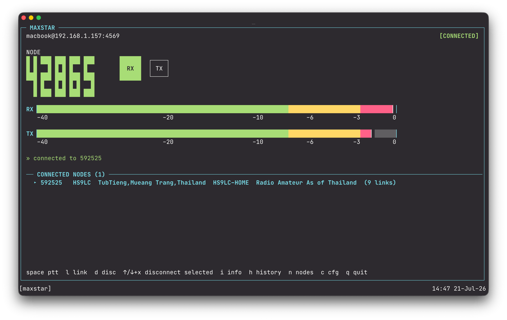

# maxstar

A minimal, hand-rolled IAX2 client (`iax_client.py`) for connecting to an
AllStarLink node from a Mac without any radio hardware or third-party
softphone. Built because Zoiper Classic is discontinued, Zoiper 5 gates
setup behind a cloud-account wizard, and droidstar-enhanced's PTT
doesn't speak app_rpt's actual keying protocol.

The name comes from James Clerk Maxwell, plus AllStar. A UI is
planned, and a radio module may be attached to the Pi later; this
client is meant to keep working as the control surface either way.

## Node vs. terminal (client)

It's easy to conflate "the node" with "the software that connects to it" — worth spelling out explicitly since this project only makes sense once the two are separated.

The Pi (your node) is the actual AllStarLink node: it runs Asterisk + app_rpt, and that's what has a node number, registers on the AllStarLink network, and gets a classification on stats.allstarlink.org. Since it has no radio hardware attached, that classification is **Hub, Terminal user only** — "Hub" meaning no RF (the node's radio input is otherwise empty), "Terminal user only" describing what that empty input is *for*: a single person connecting through a client app, as opposed to a hub whose main purpose is interlinking many other repeater nodes together. It's a label about intended use, not a technical restriction — node-to-node linking is still a separate, available mechanism (see below).

`maxstar` is the terminal — the client half. It doesn't turn the Pi's node into anything; it just occupies the one radio seat the Hub node is waiting to have filled, supplying real mic/speaker audio in/out over IAX2. Both halves are required: the Pi's Asterisk/app_rpt provides the node identity and network presence, `maxstar` provides the actual audio path a human uses. Zoiper, DVSwitch Mobile, and RepeaterPhone's "Node" auth mode (see below) all fill the same terminal role `maxstar` does — they're interchangeable clients for the same node-side setup.

That radio seat is single-occupancy — connecting a second client authenticates and immediately hangs up the first, rather than letting two people talk together (see "Single-seat connections" below). This is structural to app_rpt (one `rxchannel` per node), not a `maxstar`-specific limitation. Getting someone else to actually talk with you requires linking two separate nodes together, not a second client connection to the same one.

### RepeaterPhone comparison

RepeaterPhone (iOS) is sometimes assumed to remove the need for a Pi entirely, but that depends on which of its two auth modes is used:

- **"Node" auth** (IAX username/password from a node owner) is the same model as `maxstar` — a terminal client dialing into someone's existing, self-hosted node. Pointed at your node, it would behave exactly like `maxstar` does: same single-seat rules, still requires the Pi to be running.
- **"Account" auth** (AllStarLink web portal login) is "web transceiver" mode. The app gets a token from allstarlink.org and calls the target node directly; the target node checks that token with allstarlink.org (the stock `[allstar-public]` dialplan context does this) and connects you as a web-transceiver user. No node of your own is needed, but the target node must allow web-transceiver access and be reachable from the internet — a node behind CGNAT or without port-forwarding can't accept it.

So account mode does let you skip running a node — but only as a client of someone else's publicly reachable node. Having your own node identity, which node-to-node links need, still means running a node such as the Pi.

Node-to-node links — what gives a busy hub node its many simultaneously connected nodes — are a separate mechanism from the terminal connection `maxstar` uses, authenticated by the node's own dialplan rather than a per-user IAX account. `maxstar` doesn't participate in or configure that path at all; it only ever acts as a single terminal client filling the one radio seat described above.

## Setup

```bash
python3 -m venv .venv
.venv/bin/pip install sounddevice numpy
brew install portaudio   # if not already installed
```

## Node-side configuration

ASL3 ships a ready-made template for this in `/etc/asterisk/iax.conf`:

```
[iaxclient](!)                   ; Connect from iax client (Zoiper, DVSwitch Mobile, etc.)
type = friend
context = iax-client
auth = md5
host = dynamic
disallow = all
allow = ulaw
allow = adpcm
allow = gsm
transfer = no
#tryinclude custom/iax/iaxclient-users.conf
```

The account lives in `/etc/asterisk/custom/iax/iaxclient-users.conf`:
```
[<YOUR_USERNAME>](iaxclient)
secret = <set on the Pi — never commit this>
requirecalltoken = no
callerid = "LISTENER"
```
(`requirecalltoken = no` because most IAX clients — this one included —
don't implement the call-token challenge that `type=friend` peers
normally require.)

The dial context in `/etc/asterisk/extensions.conf`:
```
[iax-client]
exten => <YOUR_NODE>,1,rpt(<YOUR_NODE>,X)
```
Dialing your own node number (`<YOUR_NODE>`) connects you as the node's
radio input — see "Single-seat connections" below.

### Node telemetry (connect/disconnect announcements)

app_rpt can play a spoken "connected"/"disconnected" announcement on
the node itself every time a link connects or drops. This is node-wide
audio, not per-listener — it goes out over every currently-connected
link exactly like any other node audio, so everyone linked at that
moment hears it, not just whoever caused the event. `maxstar` doesn't
control this (it used to have a `t`-key toggle, since removed — the
default below is what everyone should hear, and toggling it live was
more likely to cause confusion than help).

Set this to **off** via `telemdefault = 0` in `/etc/asterisk/rpt.conf`'s
`[node-main]` template (`0` = telemetry output off; `2`, the stock
default, is "timed telemetry output on command execution and for a
short time thereafter" — the announcement that fires on every
connect/disconnect otherwise). That default only takes effect when
app_rpt itself (re)initializes — Asterisk restarting or the module
reloading — not when any client connects/disconnects, so once set it
stays off across every maxstar/Zoiper/etc. session without either of
them doing anything.

To turn it on or off for a live session (reverts to the `rpt.conf`
default on the next Asterisk restart/module reload), send the DTMF
function code from any connected client, or run it directly from the
Pi:
```
# from any connected IAX client, dial DTMF:
*935   ; telemetry on  (cop,35 -- "Local Telem mode Normal")
*934   ; telemetry off (cop,34)

# or, on the Pi itself:
asterisk -rx "rpt cmd <NODE> cop 35"   # on
asterisk -rx "rpt cmd <NODE> cop 34"   # off
```
(`cop,33`, "Local Telemetry Output Enable", looks like the obvious
choice but actually sets a different, special always-on sentinel value
that doesn't match the real announcement — confirmed against app_rpt's
own source, `rpt_config.c`/`rpt_functions.c`. Use `cop,35`/`cop,34`.)
These three function codes aren't in app_rpt's default functions
table; uncomment them in your node's `rpt.conf`
(`933`/`934`/`935` = `cop,33`/`cop,34`/`cop,35`) and reload the module
(`asterisk -rx "module reload app_rpt.so"`) before they'll respond to
DTMF at all.

To change the persistent default instead of a one-off session toggle,
edit `telemdefault` in `/etc/asterisk/rpt.conf` and reload:
```
sudo sed -i 's/^telemdefault = ./telemdefault = <0|1|2>/' /etc/asterisk/rpt.conf
sudo asterisk -rx "module reload app_rpt.so"
```

## Usage

```bash
cp .env.example .env
# edit .env: set MAXSTAR_HOST, MAXSTAR_USER, MAXSTAR_SECRET, MAXSTAR_NODE
.venv/bin/python3 iax_client.py
```

`.env` is gitignored and read automatically on startup (falls back to
real env vars of the same name if no `.env` is present). `--host`,
`--port`, `--user`, `--secret`, `--node`, `--context` all override
their `MAXSTAR_*` env var if you'd rather pass them inline. `--host`,
`--user`, `--secret`, and `--node` are required one way or
another — the client refuses to guess at your node's identity. Never
hardcode any of these as defaults in source — they get picked up by
git otherwise.

Interactive commands once connected:
- `k` — key up, start sending mic audio
- `u` — unkey, stop sending
- `q` — hang up and quit

## TUI

```bash
.venv/bin/python3 tui.py
```



Curses-based UI (stdlib `curses`, no new dependency), styled like a
rig's control panel (Icom IC-705-ish): bordered panel, a big block-digit
VFO-style readout for the node number, two RX/TX status badges drawn as
small rectangles (solid filled green/red block when active, a bordered
outline when not — a real shape change instead of just toggling text
color, so it reads clearly at a glance — RX lights up on real
received-audio activity, TX on the actual keyed state), and segmented
green/yellow/red level meters with a peak-hold marker and a dB scale row. The scale reads dBFS (audio level relative
to full scale), not S-units — IAX2 carries digitized audio, not an RF
signal report, so there's no real RSSI to show; it borrows the meter's
visual language while staying honest about what's actually being
measured.

The panel fills the whole terminal (sized from `stdscr.getmaxyx()`, not
a fixed box) and handles window resize, so it scales up nicely on a
full-size terminal window rather than sitting in a small corner.

If any required `.env` value is missing it opens straight into a config
screen instead of connecting blind:
- **Config screen**: Up/Down to select a field, Enter to edit,
  `s` to save + (re)connect, Esc to go back once connected, `q` to quit.
  Edits write straight back to `.env`.
- **Monitor screen**: Space toggles PTT (key up, key down again to
  unkey), `l` to connect to a node, `d` to disconnect one, `h` for the
  link-history screen, `n` for the nodes/favorites screen, `c` to
  reopen the config screen, `q` to quit.
  The bottom of this screen always shows a live **CONNECTED NODES**
  panel — whatever's currently linked to yours, with callsign/location
  and how many nodes *that* node is itself linked to, refreshed in the
  background — so you can see it at a glance without switching screens.
  Up/Down selects an entry, `x` disconnects the selected one directly,
  `i` opens that node's own link list (see below).
  If more than one node is linked (a multi-way net rather than a single
  link), the count is highlighted and each entry is numbered for
  clarity.

  Space is a toggle, not a real hold-to-talk button — a terminal has
  no way to detect a key being physically held down versus pressed
  repeatedly, especially over SSH where repeat timing gets mangled by
  latency, so toggle is the reliable option. The real risk with a
  toggle over a hold button is a silently "stuck" open mic (no release
  event to fall back on if you forget or mis-tap), so as a safety net
  it auto-unkeys after `TX_TIMEOUT_SECONDS` (90s) of continuous
  keyed time and shows a `TX timeout` message — the same idea as a
  repeater's own time-out timer. A countdown next to the TX badge
  (yellow, turning red under 15s) counts down while keyed so it's
  never a surprise.
- **Nodes screen** (`n`): the same connected-nodes list plus a
  favorites list, both interactive here. `a` adds a favorite by node
  number, `r` removes the selected one, Enter connects to the selected
  node, `x` disconnects it, `i` opens that node's own link list (see
  below). Favorites persist in `favorites.json`
  (gitignored, like `.env` — personal, not project data). Connect/
  disconnect both dial the node's real app_rpt function code
  (`*3<node>`/`*1<node>`) via native IAX2 DTMF signaling (BEGIN/END
  frame pairs) — confirmed against app_rpt's own functions table rather
  than assumed. Not audio-tone DTMF: that was tried first and doesn't
  work, since app_rpt's function-code decoder listens for actual DTMF
  frame events, not in-band tone detection on the rxchannel audio.
- **Node detail screen** (`i`, from a selected connected or favorite
  node on either of the two screens above): who's linked to *that*
  node right now — the same thing
  `stats.allstarlink.org/stats/<node>` shows, fetched here so there's
  no need to leave the TUI to check it. `r` forces a refresh, `i` or
  Esc goes back to whichever screen you opened it from.
- **History screen** (`h`): a log of every node that has connected
  *directly* to yours and when, newest first, with a timestamp and
  whatever callsign/location info was on hand at the time (green `+`
  for connect, red `-` for disconnect). Up/Down scrolls once it grows
  past one screenful, `r` forces an immediate refresh, `c` prompts for
  a number of days and prunes anything older (see below). This is
  deliberately *not* logged by maxstar itself — the log is written by
  a small standalone script running on the node's own Pi
  (`pi_logger/node_link_logger.py`, see "Node-side link history
  logger" below), so it keeps recording connects/disconnects even when
  no Mac is running maxstar at all. This screen just SSHes in
  (`MAXSTAR_SSH_USER`/`MAXSTAR_SSH_LOGGER_DIR`, defaulting to
  `asl`/`maxstar-logger`) and tails that log for display, or — for
  `c` — re-invokes the same script's own `--clean --keep-days N` mode
  remotely to prune it. Neither ever runs anything with `sudo`; both
  only touch a file already owned by the SSH user. Because the logger
  only ever asks `stats.allstarlink.org` for *your* node's own
  `linkedNodes`, it only ever sees direct links to your node — a node
  connected to one of your links (e.g. some third node linked to a
  node that's itself linked to you) is never logged, only that
  intermediate node itself would be.

`iax_client.py`'s own `print()` diagnostics are silenced while the TUI
is running (they'd otherwise corrupt curses' control of the screen) —
use the plain CLI with `--verbose` if you need the raw frame trace.

## Node-side link history logger

`pi_logger/node_link_logger.py` is a separate, self-contained script
(stdlib only) meant to run continuously **on the node's own Pi**, not
on the Mac — that's what lets link history keep recording connects and
disconnects even when maxstar isn't running anywhere. It polls
`stats.allstarlink.org` for the node's own direct links every 15s
(same technique and lag characteristics as the TUI's own CONNECTED
NODES panel) and appends one JSON line per connect/disconnect to a log
file. `--clean --keep-days N` prunes anything older than N days and
rewrites the file in place; the TUI's history screen (`c`) just
invokes this same flag remotely.

Deploy it once per Pi:

```bash
ssh asl@your-pi-host 'mkdir -p ~/maxstar-logger ~/.config/systemd/user'
scp pi_logger/node_link_logger.py asl@your-pi-host:~/maxstar-logger/
scp pi_logger/node-link-logger.service \
    asl@your-pi-host:~/.config/systemd/user/
# Edit YOUR_NODE_NUMBER in the copied .service file to your real node
# number first (kept out of this repo deliberately -- see below).
ssh asl@your-pi-host '\
  sed -i "s/YOUR_NODE_NUMBER/12345/" \
      ~/.config/systemd/user/node-link-logger.service && \
  systemctl --user daemon-reload && \
  systemctl --user enable --now node-link-logger'
```

Then, **run this one yourself** (it needs `sudo`, so it's not something
this client should ever run over SSH on your behalf — see the
no-sudo-over-ssh note elsewhere in this project): `sudo loginctl
enable-linger asl` on the Pi, so the user service keeps running even
with no one logged in. Without it, the logger stops the moment the SSH
session that enabled it closes.

`node-link-logger.service` ships with `YOUR_NODE_NUMBER` as a literal
placeholder rather than the real node number, on purpose — this
directory is checked into git, and the node number is the one piece of
this setup worth keeping out of a public diff even though it isn't a
secret. `MAXSTAR_SSH_USER`/`MAXSTAR_SSH_LOGGER_DIR` in `.env` must
match wherever you actually deployed it (`asl`/`maxstar-logger` by
default).

## Linking to another node (CLI)

```bash
.venv/bin/python3 iax_client.py --link '*3592525'   # connect transceive
.venv/bin/python3 iax_client.py --link '*1592525'   # disconnect
```

Same DTMF function-code mechanism as the TUI's `l`/`d`/nodes screen,
as a one-shot command.

## Diagnostic flags (no mic/speakers needed)

- `--selftest` — inject a synthetic 1kHz tone, then report what echoes
  back (frame count, bytes, peak amplitude)
- `--send-tone N` — connect, key up, send N seconds of test tone, hang up
- `--listen N` — connect and just report received audio for N seconds
- `--verbose` — print the raw `[TX]`/`[RX]` IAX2 frame trace (noisy)

These were built to debug the keying protocol without needing a human to
listen — e.g. `--listen` on one account while `--send-tone` runs on
another proves whether audio crosses between two connections.

## Protocol notes (for future changes)

All constants were pulled from Asterisk's own source rather than assumed,
since a wrong handshake/codec value fails silently:
- Frame header layout: `channels/iax2/include/iax2.h` —
  `struct ast_iax2_full_hdr` / `ast_iax2_mini_hdr`
- `IAX_COMMAND_*` / `IAX_IE_*` values: same file
- `AST_CONTROL_*` / `AST_FRAME_*` values: `include/asterisk/frame.h`
- Codec bitmask (ulaw = `1<<2`): `include/asterisk/format_compatibility.h`
- MD5 auth order (`md5(challenge + secret)`, not the reverse): confirmed
  in `channels/chan_iax2.c`
- Subclass "compression" (power-of-two encoding for large codec bitmasks,
  flagged by the `0x80` high bit): `compress_subclass()` /
  `uncompress_subclass()` in `channels/chan_iax2.c`. Not relevant for
  ulaw specifically (value 4, well under the 128 compression threshold).

**Keying is voice-frame-based, not DTMF** for this connection type ("X" /
normal-endpoint mode). On connect, app_rpt sends a `!NEWKEY1!` text frame;
the client must echo it back once, or incoming voice frames are ignored
until a 2-second (`NEWKEYTIME`) fallback timer expires. Source:
`AllStarLink/app_rpt`, `apps/app_rpt/rpt_channel.h` and `rpt_channel.c`
(`send_newkey`, `NEWKEY1STR`, `NEWKEYTIME`).

### Single-seat connections

This connection type is also **single-seat** — dialing your own node
number as the exact extension takes over the node's `rxchannel` (radio
substitute). A second simultaneous connection gets the first one hung up.
Confirmed by connecting two test accounts simultaneously and watching the
server hang up the first the instant the second authenticated. Hearing
another real participant requires a genuine node-to-node link (a
different mechanism), not a second client connection to the same
extension. This is also why AllStarLink's built-in Parrot Mode (echo
test) never plays anything back here — parrot's playback goes to other
links, not back to the one occupying the radio seat.

## Confirmed working

The node was linked to another real, busy node, and its live traffic
was heard through this client — connecting to and hearing another
node, entirely without radio hardware.

## Known rough edges

- `audioop` is deprecated (removed in Python 3.13) — fine on the 3.12
  currently installed, will need replacing (manual µ-law codec) if
  upgrading Python later.
- No retransmission/reliability logic for full frames beyond basic
  ACK/seqno tracking — fine on a local LAN, would need work for use over
  the public internet with real packet loss.
- `scallno` is hardcoded to `1` — fine for one connection at a time; would
  need to be randomized/configurable to run multiple instances from the
  same process.
